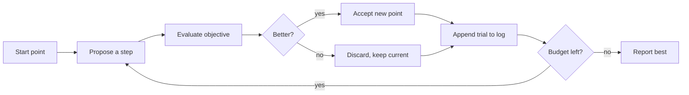

# TrialForge

**A budgeted experiment loop with keep-or-discard discipline and a log you can resume.**

Autonomous research loops work the same way in every field: propose a change, measure
it, keep it if it helped, throw it away if it did not, and write down what happened.
TrialForge is that loop as a small library and CLI — with a fixed budget, a
deterministic seed, and a JSONL log for every trial. Point it at a toy objective
first, then at your own.

[](https://github.com/abubakarsiddique360/TrialForge/actions/workflows/ci.yml)
[](pyproject.toml)
[](LICENSE)
[](pyproject.toml)

## Quick start

```bash
git clone https://github.com/abubakarsiddique360/TrialForge.git
cd TrialForge
python -m venv .venv
# Windows: .venv\Scripts\activate     macOS/Linux: source .venv/bin/activate
pip install -e ".[dev]"

trialforge run --objective sphere --strategy hill_climb --budget 60 --out run.jsonl
trialforge report run.jsonl
```

```
hill_climb on sphere: best 0.000829 at (-0.023, -0.017) (5/60 kept, 0 ms)
wrote run.jsonl
```

```
objective : sphere (hill_climb, seed 7)
trials    : 60 · kept 5 (8.3%)
best      : 0.500000 → 0.000829 (improved 0.499171)

best-so-far: █▃▃▃▃▃▃▃▂▁▁▁▁▁▁▁▁▁▁▁▁▁▁▁▁▁▁▁▁▁▁▁▁▁▁▁▁▁▁▁▁▁▁▁▁▁▁▁▁▁▁▁▁▁▁▁▁▁▁
```

## The loop



Three things are enforced rather than suggested:

- **A fixed budget.** `--budget 60` means exactly 60 evaluations. No early stopping
  that quietly changes the comparison between strategies.
- **A recorded decision.** Every trial logs its value, the best-so-far, whether it
  was kept, and a note saying why.
- **Reproducibility.** The seed drives the proposals, so the same command produces
  the same curve.

## Strategies and objectives

| Strategy | Proposes | Accepts |
| --- | --- | --- |
| `random` | uniform sample of the whole box | improvements only |
| `hill_climb` | Gaussian jitter with a step size that shrinks every 5 iterations | improvements only |
| `anneal` | Gaussian jitter with cooling | improvements, and worse points with probability `exp(-Δ/T)` |

| Objective | Landscape | Optimum |
| --- | --- | --- |
| `sphere` | smooth bowl | 0 at the origin |
| `rastrigin` | many local minima | 0 at the origin |
| `ackley` | steep rim, flat centre | 0 at the origin |

On `sphere` with the same seed, local search reliably beats uniform sampling —
that comparison is a unit test, not a claim in a README.

## Log format

One JSON object per line, header first:

```json
{"type": "run", "objective": "sphere", "strategy": "hill_climb", "budget": 60, "seed": 7, "best_value": 0.000829}
{"type": "trial", "iteration": 1, "value": 0.612, "best": 0.500, "kept": false, "note": "jitter σ=0.800"}
{"type": "trial", "iteration": 2, "value": 0.441, "best": 0.441, "kept": true, "note": "jitter σ=0.800"}
```

`trialforge report run.jsonl` summarises it; `--json` gives the same summary as an
object. `trialforge.loop.resume(path, budget)` continues a run while keeping the
earlier trials in the history.

## Using your own objective

```python
from trialforge.loop import run, write_jsonl
from trialforge.objectives import Objective


def latency(hyperparameters):
    return (hyperparameters[0] - 0.2) ** 2 + (hyperparameters[1] + 1.5) ** 2


custom = Objective("latency", latency, optimum_value=0.0, optimum_point=(0.2, -1.5), bounds=(-3.0, 3.0))
```

Strategies take the objective as an argument, so a custom objective works with the
existing loop and reporters unchanged.

## CLI

| Command | Purpose |
| --- | --- |
| `run [--objective O] [--strategy S] [--budget N] [--seed N] [--out FILE] [--json]` | Run an experiment |
| `report FILE [--json]` | Summarise a JSONL log |
| `objectives` | List objective functions |
| `strategies` | List search strategies |

Exit codes: `0` success, `2` unknown objective/strategy or unreadable log.

## Project layout

```text
src/trialforge/
├── objectives.py  sphere, rastrigin, ackley with known optima
├── strategies.py  random, hill climbing, simulated annealing
├── loop.py        the budgeted loop, JSONL logging, resume
├── report.py      summary + sparkline of the best-so-far curve
└── cli.py         run · report · objectives · strategies
tests/             27 pytest cases
```

## Limitations

- Single-objective, unconstrained (box-bounded) minimisation. No Pareto fronts, no
  constraints, no gradients.
- Two dimensions by default; higher dimensions work but the step sizes are not
  tuned for them.
- The loop is serial and in-process: one evaluation at a time.
- The demo objectives are toys. The value here is the loop discipline, not the
  optimiser — swap in your own objective and the bookkeeping still applies.

## License

[MIT](LICENSE) © 2026 **ABU BAKAR SIDDIQUE**
